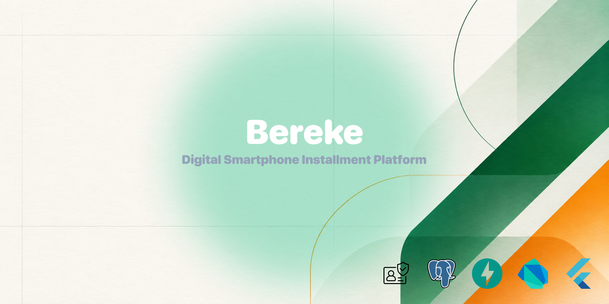

<p align="center"></p>

<div align="center">
  
# 🎯 About the Project

</div>

**bereke** eliminates complex paperwork and hidden fees when purchasing smartphones on installment plans:
- **Customers** browse the smartphone catalog, customize installment terms (3, 6, 12, or 24 months) and down payments via an interactive slider, complete digital KYC verification (ID card/passport + selfie), and receive instant scoring decisions.
- **Business (Admin Panel / CRM)** manages the smartphone catalog and installment limits, reviews applications (when manual moderation is required), and monitors sales analytics and portfolio health (NPL).

---

<div align="center">
  
# 🛠️ Tech Stack

</div>

| Layer | Technologies | Purpose |
| :--- | :--- | :--- |
| **Mobile App** | Flutter (Dart), Riverpod, GoRouter | Cross-platform client app for iOS & Android |
| **Admin / CRM** | React / Next.js | Web dashboard for moderation and analytics |
| **Backend API** | Python 3.12+, FastAPI, Pydantic v2 | Business logic, scoring integration, schedule calculation |
| **Database** | PostgreSQL 16, SQLAlchemy 2.0, Alembic | ACID-compliant storage for contracts, schedules, and transactions |
| **Cache & Queue** | Redis, Celery / Taskiq | OTP codes, payment reminders, recurring billing tasks |
| **Object Storage** | MinIO (S3) | Encrypted storage for KYC documents and product images |
| **Integrations (KG)** | Nikita.kg / SMSPro.kg, PayBox / Elcard | SMS OTP verification and recurring card acquiring |

---

<div align="center">
  
## 📁 Planned Repository Structure

</div>

```text
bereke/
├── mobile/          # Flutter mobile application (iOS / Android)
├── backend/         # FastAPI backend and REST API
├── admin/           # Admin panel / CRM web interface
├── docs/            # Technical specifications, DB schemas, and API docs
├── .gitignore       # Git ignore rules
├── LICENSE          # Proprietary license (All Rights Reserved)
└── README.md        # Project documentation
```
